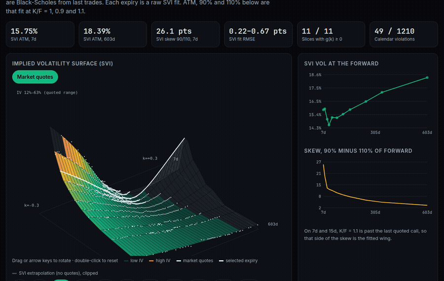
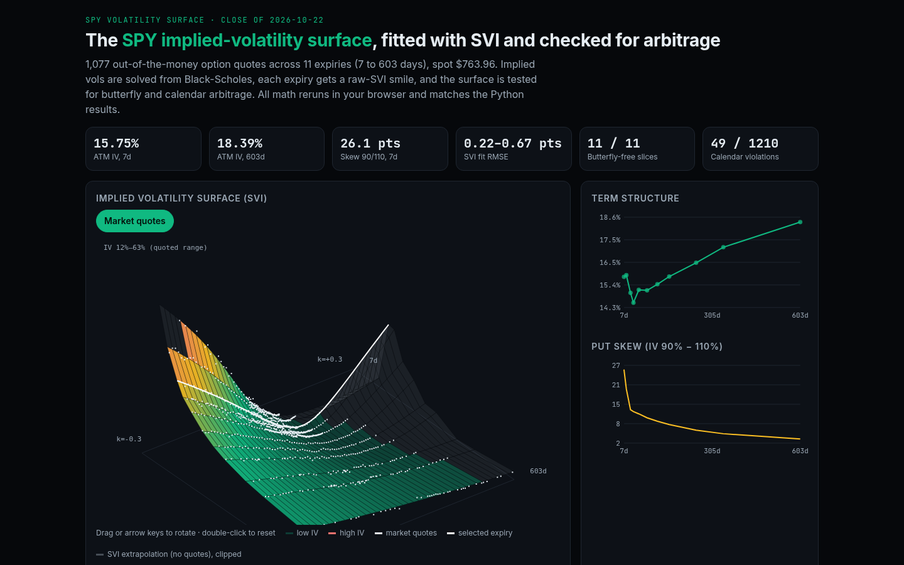
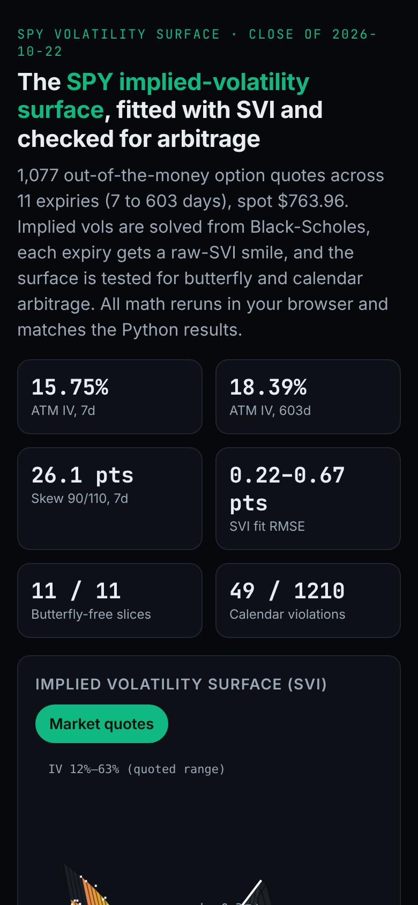
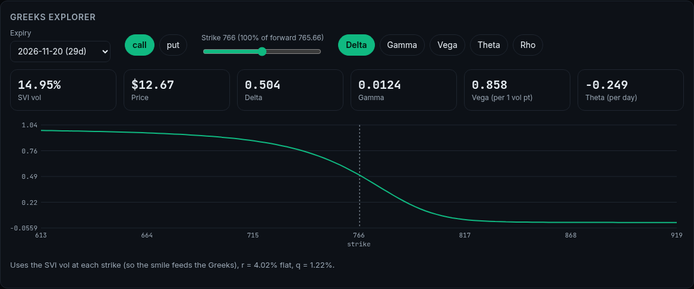
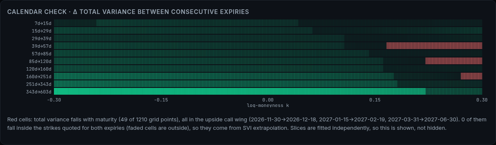

# options-vol-surface

Black-Scholes pricing and Greeks, implied-volatility solving, and an **SVI-fitted implied-volatility surface** for
SPY from a real option-chain snapshot (close of 2026-10-22), with butterfly and calendar
arbitrage checks. Every number below is generated from `results/summary.json` by `scripts/build_readme.py` and pinned
by tests.

**Live app: [parbproject.github.io/options-vol-surface](https://parbproject.github.io/options-vol-surface/)**



| Desktop | Mobile |
|---|---|
|  |  |

| Greeks explorer | Calendar check |
|---|---|
|  |  |

## What this demonstrates

- **Interactive surface:** rotatable 3D SVI surface with market quotes, smiles per expiry, a Greeks explorer driven by the SVI
  smile, and butterfly/calendar arbitrage views. Browser math is tested against the Python results.
- **Reproducible research:** frozen raw data with SHA-256 manifest, `make all` runs offline, results JSON pinned by tests,
  this README generated from the results.

## Headline

- 1077 out-of-the-money quotes across 11 expiries (7 to 603 days),
  spot $763.96.
- ATM implied vol term structure runs from 15.75% (7d) to 18.39%
  (603d), lowest at 14.52% (39d).
- Put skew (IV at 90% minus 110% moneyness) falls from 26.12 vol points at
  7d to 3.24 at 603d.
- SVI fit error (RMSE) is 0.22 to 0.67
  vol points per slice. Butterfly-arbitrage-free (Gatheral g >= 0) on 11 of 11 slices.
- Calendar check: total variance decreases with maturity at 49 of 1210
  grid points (log-moneyness -0.30 to 0.30), 0 of them inside the strikes actually
  quoted for both expiries, so they come from SVI extrapolation in the upside call wing: 2026-11-30 -> 2026-12-18: 27 points, log-moneyness 0.17 to 0.30; 2027-01-15 -> 2027-02-19: 16 points, log-moneyness 0.23 to 0.30; 2027-03-31 -> 2027-06-30: 6 points, log-moneyness 0.28 to 0.30.
  Slices are fitted independently, so this is reported, not hidden.

| Expiry | Days | Quotes | ATM IV | IV 90% | IV 110% | Skew (vol pts) | SVI RMSE (vol pts) | No butterfly arb |
|---|---|---|---|---|---|---|---|---|
| 2026-10-29 | 7 | 90 | 15.75% | 36.28% | 10.16% | 26.12 | 0.60 | yes |
| 2026-11-06 | 15 | 130 | 15.84% | 30.52% | 10.88% | 19.64 | 0.67 | yes |
| 2026-11-20 | 29 | 142 | 14.99% | 26.64% | 13.76% | 12.88 | 0.41 | yes |
| 2026-11-30 | 39 | 194 | 14.52% | 24.52% | 12.26% | 12.26 | 0.44 | yes |
| 2026-12-18 | 57 | 167 | 15.13% | 23.60% | 12.07% | 11.52 | 0.24 | yes |
| 2027-01-15 | 85 | 72 | 15.11% | 22.07% | 11.85% | 10.22 | 0.22 | yes |
| 2027-02-19 | 120 | 64 | 15.40% | 21.40% | 12.32% | 9.08 | 0.24 | yes |
| 2027-03-31 | 160 | 63 | 15.77% | 20.75% | 12.76% | 7.99 | 0.23 | yes |
| 2027-06-30 | 251 | 51 | 16.43% | 20.26% | 14.15% | 6.11 | 0.34 | yes |
| 2027-09-30 | 343 | 62 | 17.18% | 20.15% | 15.17% | 4.97 | 0.37 | yes |
| 2028-06-16 | 603 | 42 | 18.39% | 20.21% | 16.98% | 3.24 | 0.43 | yes |

### Greeks example: 29-day, strike 766, SVI vol 14.95%, call price $12.67

Vega and rho per 1.00 change, theta per year.

| Greek | Call | Put |
|---|---|---|
| delta | 0.5037 | -0.4953 |
| gamma | 0.0124 | 0.0124 |
| vega | 85.8196 | 85.8196 |
| theta | -91.0051 | -69.6423 |
| rho | 29.5681 | -31.0980 |

## Method

- Inputs: rate 4.02% (13-week T-bill (^IRX), flat across maturities); dividend yield 1.22% (trailing-12-month
  cash dividends / spot, continuous). Forward F = S e^((r-q)T); log-moneyness k = ln(K/F).
- Filters: last trade on 2026-10-22, price >= $0.05, volume > 0, OTM only,
  |k| <= 0.35, at least 5 days.
- IV: Brent root-finding on Black-Scholes-Merton, rejecting prices outside no-arbitrage bounds.
- SVI: raw parameterisation w(k) = a + b(rho(k-m) + sqrt((k-m)^2 + sigma^2)), least squares on total variance.

## Data limits (read before reusing)

- yfinance option chains are **current-only**: there is no historical chain, so this is a single frozen snapshot
  (taken 2026-10-23T05:01:11+00:00 UTC) and cannot be re-downloaded. `make fetch` would produce a different date.
- The snapshot was taken outside market hours, so bid/ask were 0 for most contracts (165 of
  3682 had a bid). IVs use **last-trade prices**, which are not synchronous with the spot close.
- A flat short rate and a trailing dividend yield are approximations; no put-call-parity forward is implied.

## Reproduce

```bash
pip install -e .[dev]
make all      # verify hashes, run analysis, rebuild README, ruff, pytest (offline)
make web      # export app data, run Node parity tests, build the React app (Node 20+)
make deploy   # publish web/dist to the gh-pages branch
```
